<div align="center">


# Pokédex Tracker

**Track a Gen III–IV living dex on every device, with save-file import, encounters by route, and the calculators you need along the way.**

[](https://github.com/Jabberwocky7777/Pokedex-Tracker/actions/workflows/ci.yml)
[](https://github.com/Jabberwocky7777/Pokedex-Tracker/releases/latest)
[](LICENSE)


</div>

All 493 Pokémon of Generations I–IV, in the games you are playing: Ruby, Sapphire, Emerald, FireRed, LeafGreen, Diamond, Pearl, Platinum, HeartGold and SoulSilver. Your data stays on your device; an optional server you host yourself keeps your PC and phone in sync.

## Screenshots

<p align="center">
  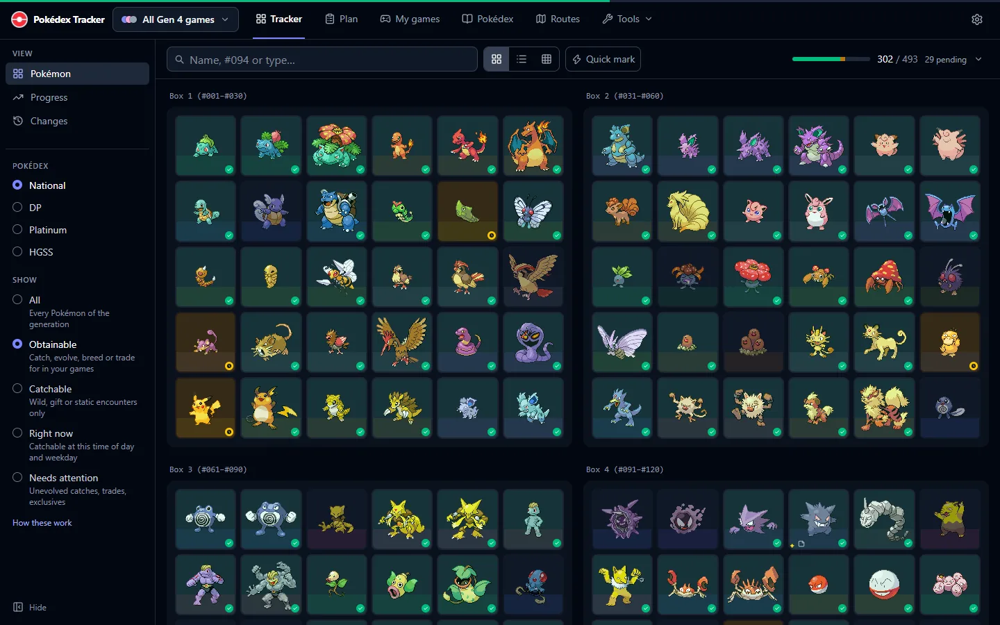
</p>

|                                                                                                                              |                                                                                                                      |
| ---------------------------------------------------------------------------------------------------------------------------- | -------------------------------------------------------------------------------------------------------------------- |
| 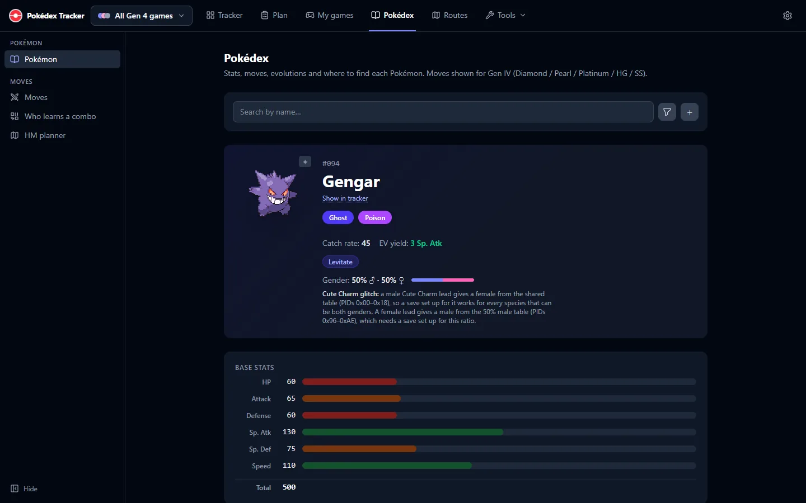 | 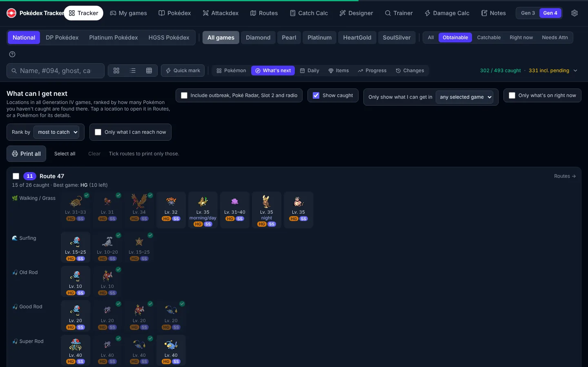 |
| **Pokédex**: Gen IV stats, moves and locations                                                                               | **What's next**: where to go for what's missing                                                                      |
| 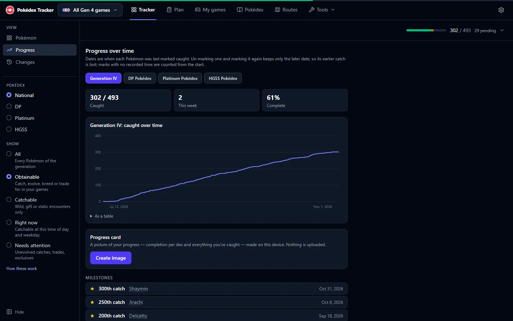                            | 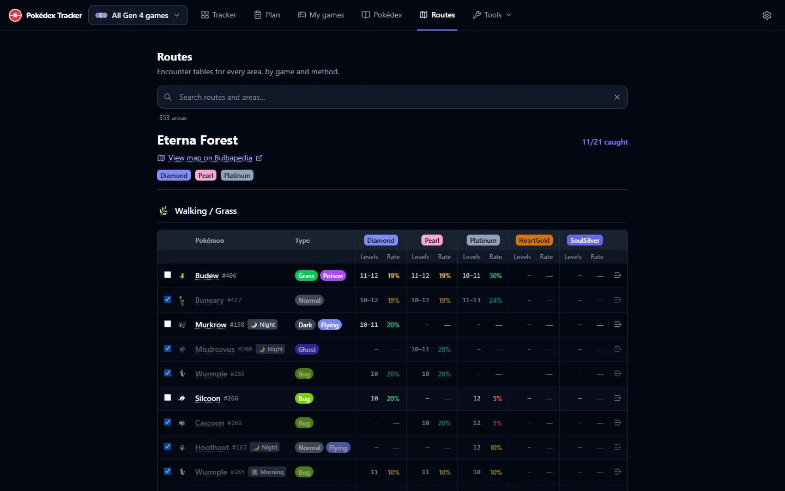              |
| **Progress**: catches over time and milestones                                                                               | **Routes**: encounter tables by game, method and time                                                                |
| 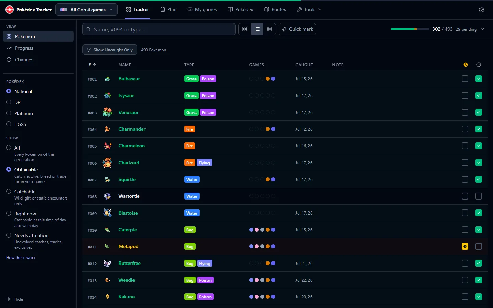                         | 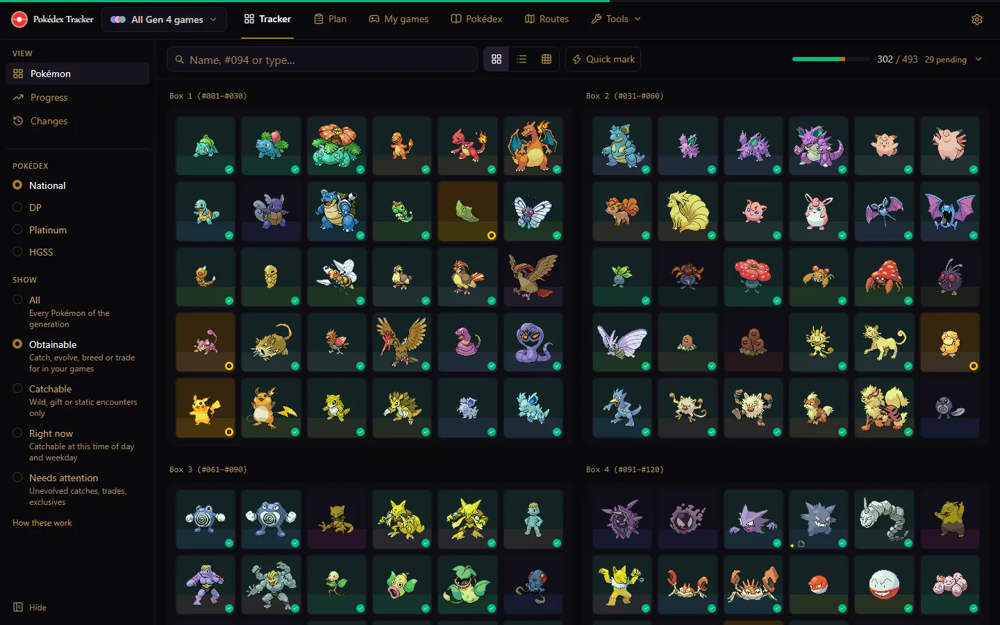                 |
| **List view**: sortable, with notes and caught dates                                                                         | **Burnished theme**                                                                                                  |

<p align="center">
  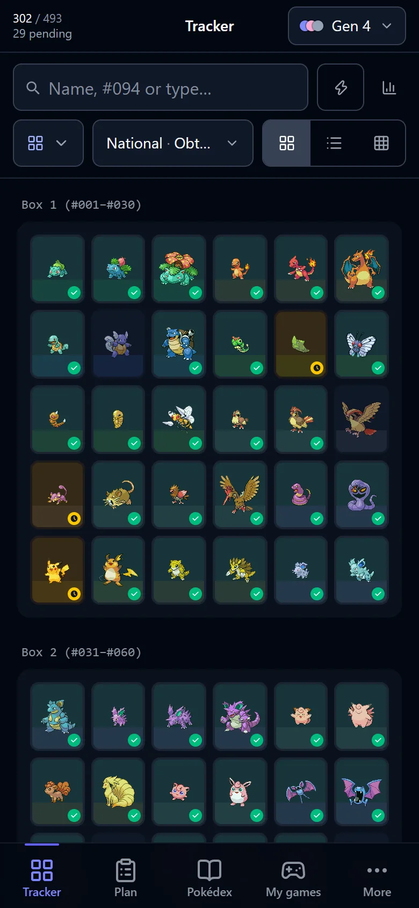
  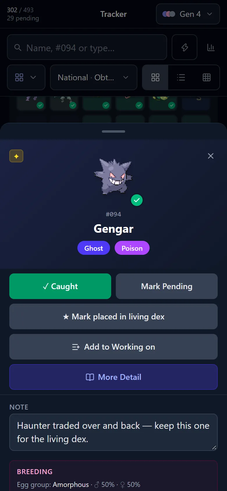
  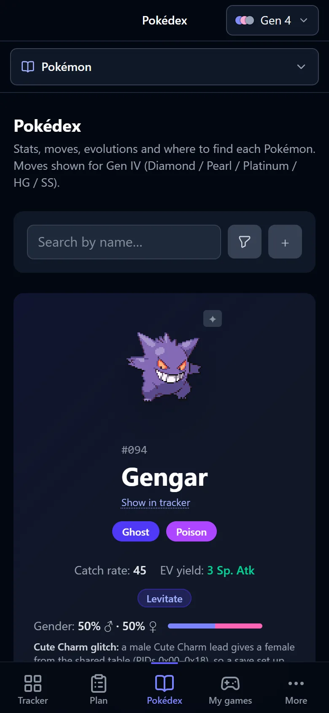
</p>

## Features

- **Tracker**: box, list and PC-slot views with caught, pending, shiny and placed marks; filter by game, regional dex and what you can actually get; every change has Undo and a change log.
- **Save import**: read a `.sav` from any of the ten games in the browser (never uploaded), browse the boxes, review the marks it proposes, and plan a living dex with a to-do list, transfers and trades.
- **What can I get next**: the routes in your games ranked by how many uncaught Pokémon they have, with encounter rates, time of day and weekday events; printable, or saved as phone-sized images.
- **Pokédex, Attackdex and Routes**: stats, learnsets, evolutions, breeding and where to find each Pokémon, as they were in Gen III/IV; every Pokémon, move and place links to its page.
- **Calculators**: catch rate, Gen IV damage, a team designer with IV/EV tools, and every Battle Tower trainer set.
- **Notes**: per-Pokémon notes, a "working on" list, a run journal and a shiny hunt counter, all synced and printable.
- **Works offline**: installs as an app and opens with no connection once loaded.
- **Sync**: a small self-hosted server merges changes entry by entry, so two devices never overwrite each other; server snapshots let you undo a bad day.

<p align="center">
  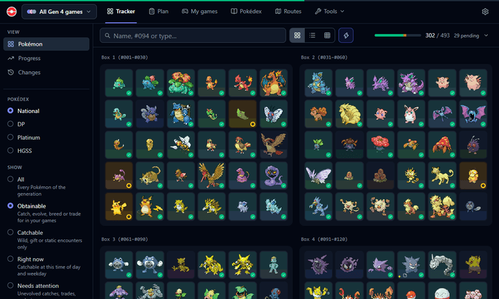
</p>

The full list, tab by tab, is in [docs/features.md](docs/features.md).

## Install

### Web app (PWA)

Open an instance in any current browser, then choose **Use offline** (data stays on the device) or sign in to your sync server. **Install app** or **Add to Home Screen** gives you an icon that works offline. You need an instance to open: host one with Docker (below), unzip `pokedex-tracker-web-*.zip` from a [release](https://github.com/Jabberwocky7777/Pokedex-Tracker/releases) onto any static host (offline only, no sync), or run it locally (see [Development](#development)).

### Docker (web app + sync server)

One image holds the web app and the sync server:

```bash
cp .env.example .env    # set APP_USER, APP_PASSWORD and SYNC_TOKEN
docker compose -f deploy/docker-compose.yml up -d
```

Then open `http://<your-server>:7777`. The image is `ghcr.io/jabberwocky7777/pokedex-tracker:latest`, rebuilt on every push to `main`. TrueNAS SCALE steps, reverse proxies, rate limits and updating: [docs/self-hosting.md](docs/self-hosting.md).

### iOS (AltStore / SideStore)

Add this source in AltStore or SideStore and install **Pokédex Tracker** from it:

```
https://jabberwocky7777.github.io/Pokedex-Tracker/apps.json
```

New versions appear there as updates. On first launch, enter your server's address or choose **Use offline**. More in [docs/ios.md](docs/ios.md).

## Self-hosted sync

The sync server runs inside the Docker image. It is meant for **one person or one household**: there are no separate accounts, and everyone who signs in shares one Pokédex. Put it behind HTTPS before exposing it to the internet.

| Variable          | Required | Default                     | What it does                                                                                                                                                                |
| ----------------- | -------- | --------------------------- | --------------------------------------------------------------------------------------------------------------------------------------------------------------------------- |
| `APP_USER`        | Yes      | —                           | Username for the login screen                                                                                                                                               |
| `APP_PASSWORD`    | Yes      | —                           | Password for the login screen                                                                                                                                               |
| `SYNC_TOKEN`      | Yes      | —                           | The secret every signed-in device uses. Generate one with `openssl rand -hex 32`                                                                                            |
| `CORS_ORIGIN`     | No       | empty                       | Extra origins allowed to call the API from another site, comma-separated. The web app (same origin) and the iOS app (`capacitor://localhost`) need nothing here             |
| `TRUSTED_PROXIES` | No       | loopback and private ranges | Reverse proxies whose `X-Forwarded-For` names the real client (comma-separated addresses or CIDRs, or `none`). The rate limits count per client, so set this behind a proxy |

The container listens on port 80 (mapped to 7777 in the compose file) and keeps its data in the `/data` volume. Every sync is pull, merge, push: marks merge one Pokémon at a time by timestamp, and the server keeps the copies replaced by the last 10 syncs plus hourly and daily snapshots, which you can restore from Settings. How the merge works: [docs/sync.md](docs/sync.md).

## Development

Needs Node.js 22 or later.

```bash
git clone https://github.com/Jabberwocky7777/Pokedex-Tracker.git
cd Pokedex-Tracker
npm install
npm run dev        # http://localhost:5173
```

| Command                              | What it does                                            |
| ------------------------------------ | ------------------------------------------------------- |
| `npm run dev`                        | Vite dev server with hot reload                         |
| `npm test`                           | Vitest, then the sync server's tests                    |
| `npm run lint` / `npm run typecheck` | ESLint / TypeScript (app and scripts)                   |
| `npm run format`                     | Prettier                                                |
| `npm run build`                      | Production build into `dist/`                           |
| `npm run e2e`                        | Browser click-through with Playwright                   |
| `npm run generate-data`              | Rebuild the Pokémon data from PokéAPI, then validate it |

Running the sync server locally, search syntax and keyboard/touch controls: [docs/development.md](docs/development.md). The data pipeline: [docs/data-pipeline.md](docs/data-pipeline.md). How to contribute: [CONTRIBUTING](.github/CONTRIBUTING.md). Release history: [CHANGELOG.md](CHANGELOG.md).

Built with React 19, TypeScript, Zustand, Tailwind CSS 4, Vite and Capacitor; the sync server is Express.

## Project structure

```
src/              the app: components/ (one folder per tab), lib/ (pure logic, no React),
                  lib/save/ (Gen III/IV save readers), store/ (Zustand), hooks/, data/, themes/
public/data/      generated Pokémon, move and learnset data, loaded at runtime
sync-server/      Express API: login, pull, push, snapshots; stores one JSON file
scripts/          data generators, validation, screenshots, e2e, release helper
deploy/           Dockerfile, compose file, nginx config, entrypoint, smoke test
ios/              Capacitor iOS project
docs/             user and self-hosting guides, screenshots, past code reviews
apps.json         the AltStore / SideStore source (served by GitHub Pages)
```

[CLAUDE.md](CLAUDE.md) is the detailed map: every store, tab and module, how sync merges, and the data pipeline.

## Data sources and licensing

- **Code**: [MIT](LICENSE).
- **Pokémon data** (species, stats, encounters, moves, learnsets in `public/data/` and `src/data/`): generated from [PokéAPI](https://github.com/PokeAPI/pokeapi) at a pinned commit. PokéAPI's data is licensed [CC BY-NC-SA 4.0](https://creativecommons.org/licenses/by-nc-sa/4.0/), and that licence, not MIT, applies to the generated data files: you may share and adapt them for **non-commercial** use, with attribution, under the same licence.
- **Game-derived corrections** (encounter tables, Battle Tower sets, save-file offsets, game progress) were checked against or extracted from the [pret](https://github.com/pret) decompilation projects. Battle Tower trainer rosters come from [altissimo1.github.io](https://altissimo1.github.io/). Evolution item locations follow [Bulbapedia](https://bulbapedia.bulbagarden.net/).
- **Sprites** are loaded at runtime from PokéAPI's sprite repository and are not part of this repository.
- **Font**: Cormorant Garamond, [SIL Open Font License](public/fonts/OFL.txt).

## Trademark disclaimer

Pokémon and all related names are trademarks of Nintendo, Game Freak and Creatures Inc. This is an unofficial fan project, not affiliated with or endorsed by Nintendo, Game Freak, Creatures Inc. or The Pokémon Company. No game code or ROM is included.
