<div align="center">


# Pokédex Tracker

**Track a Gen III–IV living dex on every device — with save-file import, encounters by route, and the calculators you need along the way.**

[](https://github.com/Jabberwocky7777/Pokedex-Tracker/actions/workflows/ci.yml)
[](LICENSE)
[](https://github.com/Jabberwocky7777/Pokedex-Tracker/releases/latest)


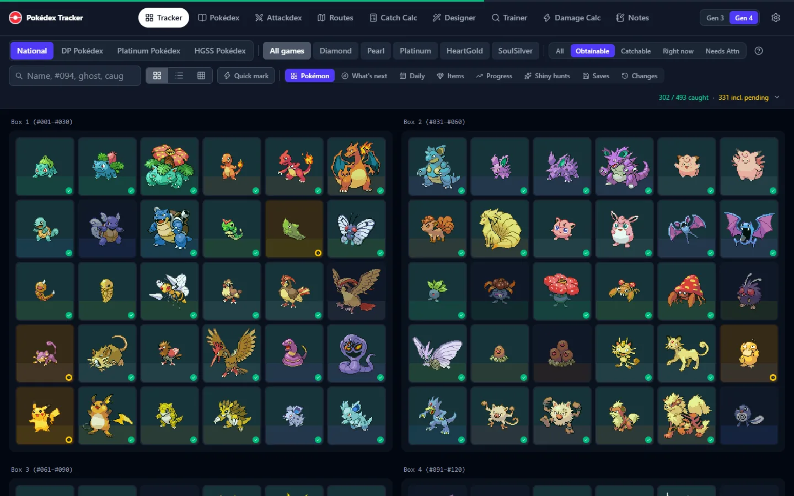

</div>

All 493 Pokémon of Generations I–IV, in the games you are playing — Ruby, Sapphire, Emerald, FireRed, LeafGreen, Diamond, Pearl, Platinum, HeartGold and SoulSilver. Your data stays in your browser; an optional server you host yourself keeps your PC and phone in sync.

## Features

- **Tracker** — box, list and PC-slot views with caught, pending, shiny and placed marks; filter by game, regional dex and what you can actually get; every change has Undo and a change log
- **Save import** — read a `.sav` from any of the ten games right in the browser (never uploaded): browse the boxes, review the marks it proposes, plan a living dex with a to-do list, transfers and trades
- **What can I get next** — the routes in your games ranked by how many uncaught Pokémon they have, with encounter rates, time of day and weekday events; printable
- **Pokédex, Attackdex and Routes** — stats, learnsets, evolutions, breeding and where to find each Pokémon, as they were in Gen III/IV; everything links to everything
- **Calculators** — catch rate, Gen IV damage, a team designer with IV/EV tools, and every Battle Tower trainer set
- **Notes** — per-Pokémon notes, a "working on" list and a run journal, all synced and printable
- **Works offline** — installs as an app, and opens with no connection once loaded
- **Sync** — a small self-hosted server merges changes entry by entry, so two devices never overwrite each other; hourly server snapshots let you undo a bad day

The full list, tab by tab, is in [docs/features.md](docs/features.md).

<p align="center">
  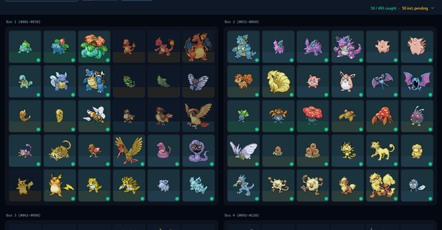
</p>

## Screenshots

| | |
|---|---|
| 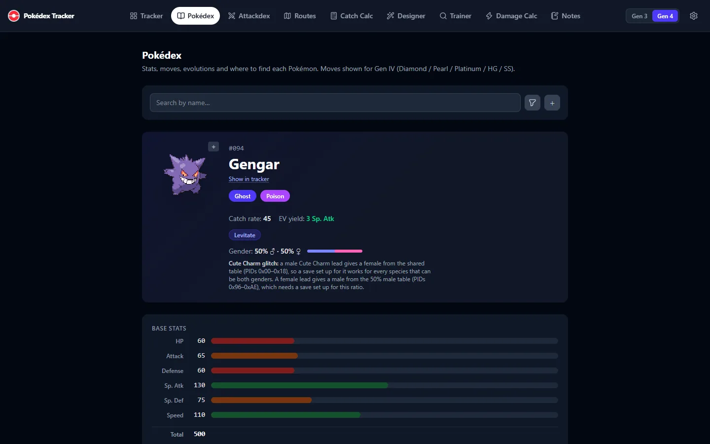 | 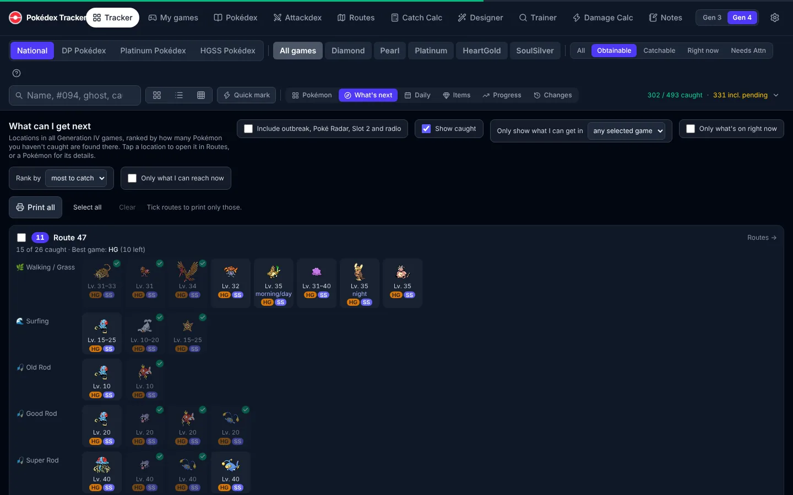 |
| **Pokédex** — Gen IV stats, moves and locations | **What's next** — where to go for what's missing |
| 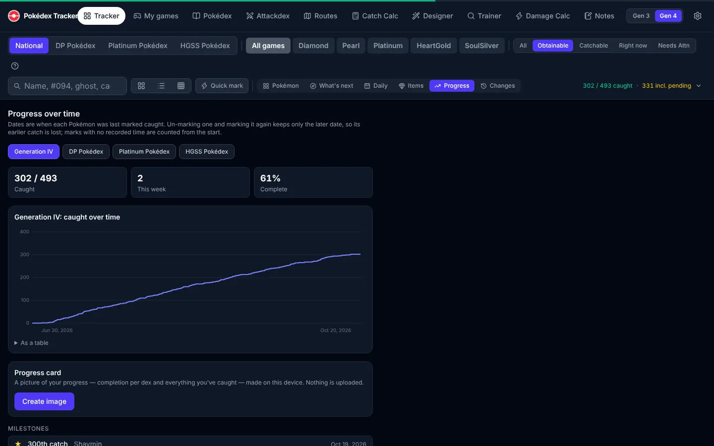 | 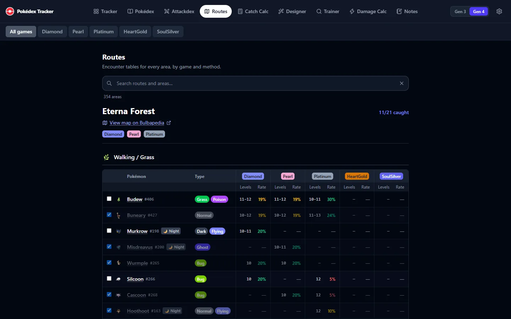 |
| **Progress** — catches over time and milestones | **Routes** — encounter tables by game, method and time |
| 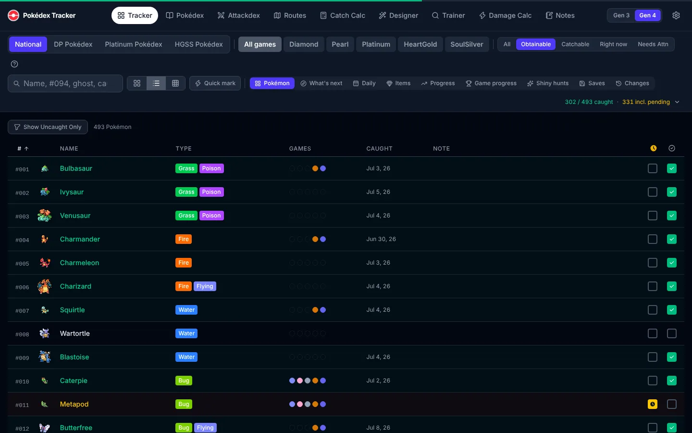 | 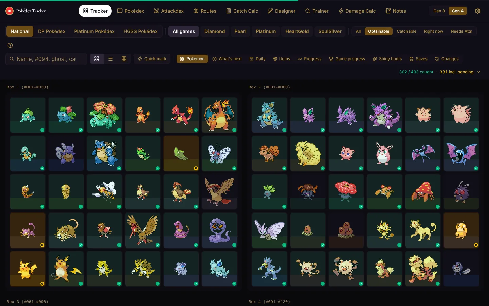 |
| **List view** — sortable, with notes and caught dates | **Burnished theme** |

<p align="center">
  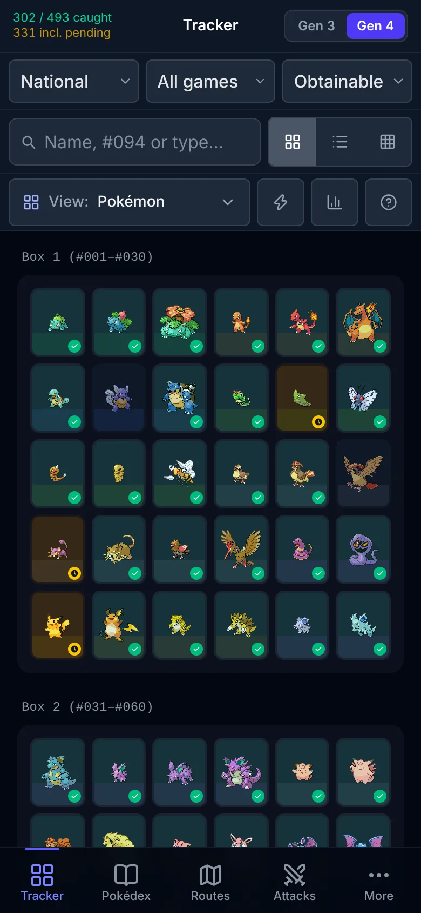
  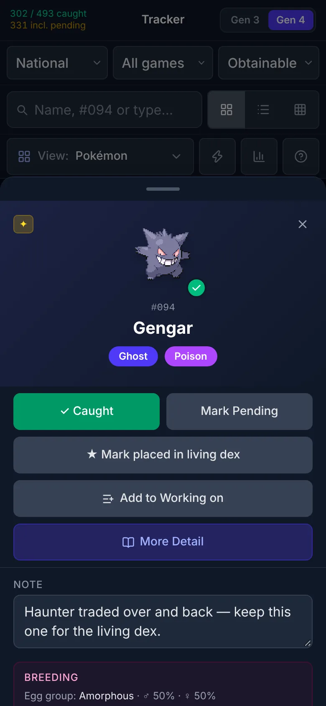
  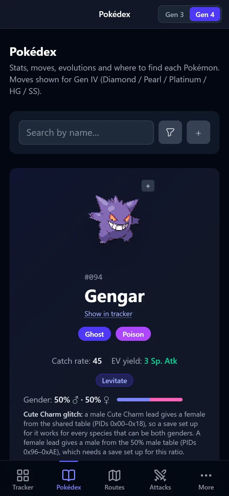
</p>

## Install

### Web

The app is a progressive web app: open it in any current browser, choose **Use offline** (data stays on the device) or sign in to your sync server, and use **Install app** / **Add to Home Screen** to get it as an icon. You need an instance to open — host one with Docker (below) or run it locally (see [Development](#development)).

### Self-host with Docker

One image holds the web app and the sync server:

```bash
cp .env.example .env    # set APP_USER, APP_PASSWORD and SYNC_TOKEN
docker compose -f deploy/docker-compose.yml up -d
```

Then open `http://<your-server>:7777`. TrueNAS SCALE steps, reverse proxies, rate limits and updating: [docs/self-hosting.md](docs/self-hosting.md).

### iOS (AltStore / SideStore)

Add this source in AltStore or SideStore and install **Pokedex Tracker** from it:

```
https://jabberwocky7777.github.io/Pokedex-Tracker/apps.json
```

On first launch, enter your server's address or choose **Use offline**. More in [docs/ios.md](docs/ios.md).

## Sync server setup

The sync server is in the Docker image; it needs three environment variables:

| Variable | |
|---|---|
| `APP_USER`, `APP_PASSWORD` | What you type on the login screen |
| `SYNC_TOKEN` | The secret every signed-in device uses — `openssl rand -hex 32` |

It is meant for **one person or one household**: there are no separate accounts, and everyone who signs in shares one Pokédex. Put it behind HTTPS before exposing it to the internet. Every sync is pull → merge → push, marks merge one Pokémon at a time by timestamp, and the server keeps hourly and daily snapshots you can restore from Settings. Details: [docs/sync.md](docs/sync.md) and [docs/self-hosting.md](docs/self-hosting.md).

## Development

Node.js 22 or later.

```bash
git clone https://github.com/Jabberwocky7777/Pokedex-Tracker.git
cd Pokedex-Tracker
npm install
npm run dev        # http://localhost:5173
```

Scripts, running the sync server locally, search syntax and keyboard/touch controls: [docs/development.md](docs/development.md). The data pipeline (PokéAPI at a pinned commit, validated as of Generation IV): [docs/data-pipeline.md](docs/data-pipeline.md).

Built with React 19, TypeScript, Zustand, Tailwind CSS 4, Vite and Capacitor; the sync server is Express.

## Contributing

Issues and pull requests are welcome — read [CONTRIBUTING](.github/CONTRIBUTING.md) first. Please never attach real save files or backups; they contain your trainer data.

## License

[MIT](LICENSE).

Pokémon data comes from [PokéAPI](https://pokeapi.co/) ([CC BY-NC-SA 4.0](https://creativecommons.org/licenses/by-nc-sa/4.0/)) and the [pret](https://github.com/pret) decompilations. Pokémon and all related names are trademarks of Nintendo, Game Freak and Creatures Inc. This project is not affiliated with or endorsed by Nintendo, Game Freak or The Pokémon Company.
